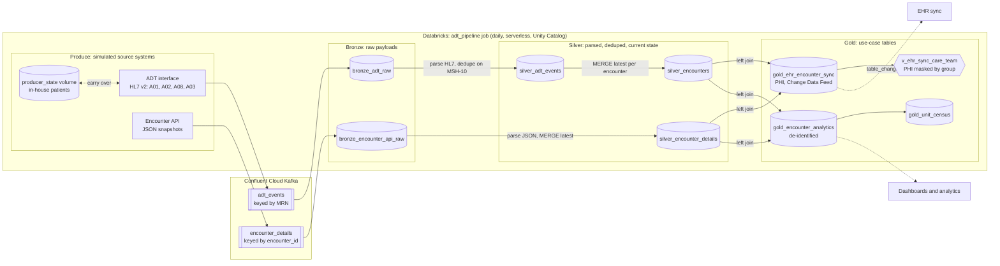

# kafka_project_1: HL7 ADT streaming on Databricks

An end-to-end healthcare streaming pipeline. A Python producer simulates a hospital ADT interface (HL7 v2) plus an encounter-details API, both publishing to **Confluent Cloud Kafka**. **Databricks** Structured Streaming lands the messages in Delta tables and refines them through bronze → silver → gold into an EHR sync feed and a de-identified analytics model.

A scheduled Databricks job runs the whole thing daily: the producer admits a random 32–84 new patients and continues the stays of those already in-house, then bronze, silver and gold process whatever arrived.

All patient data is synthetic (Faker).

## Architecture



In a real hospital, the interface engine would publish ADT messages to Kafka, and the produce task wouldn't exist. The ADT feed would also trigger a queue of `encounter_id`s, and a worker would call the EHR's API for each one. Here the producer publishes the "API response" straight to the `encounter_details` topic. Everything downstream works the same either way.

## Design decisions

- **Bronze keeps payloads untouched.** If parsing logic changes, silver can be rebuilt from bronze without depending on Kafka retention.
- **HL7 is parsed with native Spark functions, not a Python UDF.** Parsing stays in the JVM, and missing fields return NULL (`get`, `try_to_timestamp`) instead of failing the batch.
- **Duplicates are dropped on MSH-10,** the message control ID, within a watermark on Kafka arrival time. A watermark on HL7 event time would silently drop legitimately late messages, such as a delayed A03.
- **Each micro-batch is reduced to one row per key before MERGE.** MERGE fails when several source rows match one target row, for example an A01 and an A02 for the same encounter in one batch.
- **Updates only apply when newer** (`WHEN MATCHED AND s.ts > t.ts`), so out-of-order delivery can't roll an encounter back to an older state.
- **Missing API details don't block the pipeline.** The gold join is a left join, and those encounters are flagged `PENDING_DETAILS`.
- **The EHR feed only sends what changed.** A row hash skips no-op updates, and Change Data Feed exposes exactly which rows each run inserted or updated.
- **PHI is separated by use case:** an identified EHR feed, a de-identified analytics table, and masking on the consumer side so the pipeline never reads redacted values.
- **Least-privilege credentials:** the producer has a write-only Kafka key and bronze has a read-only one, both read from a Databricks secret scope.
- **Dev never publishes.** The dev copy of the job reads the same topics as prod, so its producer runs in dry-run mode. Otherwise dev-only patients would show up in prod's census and never be discharged.

## Layout

| Path | What it does |
|---|---|
| `notebooks/00_setup.py` | Creates the schema and volumes, and checks that Kafka secrets exist |
| `notebooks/01_produce_events.py` | Runs the producer as the job's first task: random 32–84 admits, state kept in a volume |
| `notebooks/02_bronze_ingest.py` | Two Kafka topics → raw bronze tables |
| `notebooks/03_silver_parse_and_stitch.py` | HL7 parsing with native Spark functions, dedupe on MSH-10, encounter state via `foreachBatch` + `MERGE` |
| `notebooks/04_gold_ehr_and_analytics.py` | Stitched EHR feed with Change Data Feed, de-identified analytics, unit census, PHI-masking view |
| `producer/produce_events.py` | Simulates admit/transfer/update/discharge journeys and API snapshots. Used by notebook 01, or run locally |

The notebooks use Databricks **source format**: `.py` files where `# COMMAND ----------` separates cells and `# MAGIC %md` / `# MAGIC %sql` mark Markdown and SQL cells. Databricks opens them as normal notebooks, and git diffs stay readable.

### What the synthetic data includes

- **Patient journeys:** A01 admit, then an A02 transfer and an A08 update along the way, then an A03 discharge.
- **Carry-over between runs:** patients still in-house at the end of a run are saved (to the `producer_state` volume in the job, or `producer/state/in_house.json` locally, which is git-ignored). The next run continues their stays, so the gold EHR feed sees real updates (transfers, discharges) and not just new admits. `--fresh` starts over.
- **Two API snapshots per encounter:** one at admit with the principal diagnosis, and a fuller one at discharge that adds a secondary diagnosis and the discharge disposition.
- **Realistic messiness:**
  - About 2% of ADT messages are resent (deduped in silver).
  - About 5% of encounters never get API details (they show as `PENDING_DETAILS` in gold).

## 1. Connect GitHub ↔ Databricks

1. In Databricks, click your avatar → **Settings → Linked accounts** and connect GitHub.
2. Go to **Workspace → Create → Git folder** and paste this repo's URL.
3. Edit in VS Code and push, then **Pull** in the Git folder. You can also edit in Databricks and commit from the Git folder UI.

## 2. Confluent Cloud

1. Sign up at confluent.cloud (new accounts get free credits) and create a **Basic** cluster.
2. Create two topics: `adt_events` and `encounter_details`.
3. Create two **service accounts**, each with an API key, so each side only gets the access it needs:

   | Service account | Used by | ACLs |
   |---|---|---|
   | `databricks-producer` | Databricks secret scope (`producer-api-*`), optionally `.env` for local runs | **Write** + **Describe** on topics `adt_events` and `encounter_details` |
   | `databricks-consumer` | Databricks secret scope | **Read** + **Describe** on both topics, plus **Read** on consumer group prefix `spark-kafka-source` |

   A service account key's permissions come from that account's ACLs, which can cover any number of topics. For quick local testing, a key tied to your own user account also works. It has your full permissions on the cluster, so keep it out of shared environments. Copy each key's secret and the cluster's bootstrap server.

## 3. Credentials

**Locally** (for the producer):

```bash
cp .env.example .env    # then fill it in. .env is git-ignored
python3 -m venv .venv && source .venv/bin/activate
pip install -r producer/requirements.txt

python producer/produce_events.py --dry-run          # preview messages, no Kafka needed
python producer/produce_events.py --encounters 50    # send to Confluent
```

**In Databricks** (for notebooks 01 and 02). A secret scope keeps credentials out of notebooks:

```bash
brew tap databricks/tap && brew install databricks
databricks auth login --host https://<your-workspace>.cloud.databricks.com

databricks secrets create-scope kafka
databricks secrets put-secret kafka bootstrap-servers
databricks secrets put-secret kafka api-key
databricks secrets put-secret kafka api-secret            # read-only consumer key
databricks secrets put-secret kafka producer-api-key
databricks secrets put-secret kafka producer-api-secret   # write-only producer key
```

## 4. Run

Normally the job runs everything (next section). To run by hand:

1. **`00_setup`:** set the `catalog` widget to your workspace's catalog (often `workspace`).
2. **`01_produce_events`:** set `producer_dry_run` to `false` to publish. Or run the producer locally.
3. **`02` → `03` → `04`:** run them in order.
4. **Repeat:** produce again, then re-run 02–04. Only new messages get processed, because the checkpoints track Kafka offsets. Gold only reports the encounters that changed.

## 5. Orchestration (Databricks Asset Bundle)

`databricks.yml` defines a Lakeflow Job that runs `setup → produce → bronze → silver → gold` on serverless compute every day at 6:00 AM Mountain time. Bronze and silver retry once, failures send an email, and `max_concurrent_runs: 1` stops two runs from writing to the same streaming checkpoints at the same time.

```bash
databricks bundle validate
databricks bundle deploy -t dev && databricks bundle run -t dev adt_pipeline   # schedule paused, producer dry run, writes to adt_demo_dev
databricks bundle deploy -t prod                                                 # scheduled, writes to adt_demo
databricks bundle run -t prod adt_pipeline --params encounters=500               # one-off run with a fixed admit count
```

Deploying a bundle is a separate step from syncing the Git folder. Pulling in Databricks updates the files but doesn't create or change the job.

## Ideas to extend

- Rewrite silver as a **Lakeflow Declarative Pipeline** with expectations, such as "admit_ts not null" or "event_type in (A01, A02, A03, A08)", and a quarantine table
- Handle A11/A13 cancel events (cancel admit, cancel discharge)
- Add the AI/BI dashboard on `gold_unit_census` and `gold_encounter_analytics` to the bundle (`resources.dashboards`)
